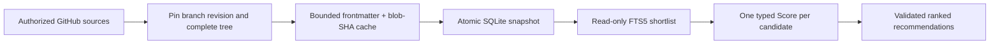

<div align="center">

# Skill router

### Retrieve skill metadata and rank it with a selected decision provider.

**GitHub metadata → SQLite FTS5 → typed decision provider → ranked recommendations**

[](https://github.com/King4s/skill-router/actions/workflows/verify.yml)


[Quick start](#quick-start) · [MCP tools](#mcp-tools) · [Safety](#safety-and-limits) · [Verification](#verification) · [Sources](https://github.com/King4s/skill-router/blob/main/Skills-list.md)

</div>

---

A native Rust MCP server that recommends third-party agent skills for a project.
It retrieves deduplicated metadata with SQLite FTS5/BM25, then sends **one comparable
typed Score per candidate**, in batches of at most 128 questions, to one configured
provider, with Jev primary and OpenAI fallback by default. It never installs or executes skills; the Python `route` command only
marks which recommendations are already installed on the machine.

The native server is **Unix-only**: `src/main.rs` installs Unix signal handlers and the
`jev-skill-refresh` utility hard-codes a Linux service layout, so `cargo build` fails on
Windows. The Python CLI is the supported entry point there.

The Python indexer (with PyYAML) and evaluation scripts are **offline tooling**.
The Rust service opens SQLite read-only and calls the selected provider directly: no Python wrapper,
shell subprocess, or skill execution in the runtime.

Native configurable providers were merged in [PR #5](https://github.com/King4s/skill-router/pull/5).
This release also preserves the existing exact-skill exclusion guard: both search
and routing filter before truncating the shortlist and reload configured policy
on each request. Repository publication does not itself update a running service.
The dated 2026-10-11 receipts below remain historical Jev/snapshot evidence, not
proof of a later deployment or live Perplexity success.

## Quick start

Requirements: Rust/Cargo, Python 3 with SQLite FTS5, authenticated [GitHub CLI](https://cli.github.com/),
and the selected decision provider's API key for ranking. Retrieval needs no model key.
This checkout includes the native implementation introduced by
[PR #1](https://github.com/King4s/skill-router/pull/1).
The refresh utility consumes `main`'s source list without importing its executable code.

```sh
git clone https://github.com/King4s/skill-router.git
cd skill-router
python3 -m venv .venv
. .venv/bin/activate
python3 -m pip install -r requirements-offline.txt
python3 -B router.py index --workers 16
python3 -B router.py stats
cargo build --release --locked
```

Put the selected profile's key in your client's protected environment (`TYPESAFE_API_KEY`
for the shipped default Jev profile). Start a **stdio MCP** server:

```sh
SKILL_ROUTER_DB="$PWD/skills.db" SKILL_ROUTER_PROVIDERS_FILE="$PWD/decision-providers.json" ./target/release/jev-skill-router
```

The client owns stdin/stdout. Logs go to stderr; closing stdin shuts down the process.
The native service does **not** read Python's fallback key file. Supply its key explicitly.

### Native decision providers

At startup, the runtime loads `decision-providers.json` from its working directory
or `SKILL_ROUTER_PROVIDERS_FILE`. The shipped default is **Jev primary → OpenAI
fallback**. The fallback receives only candidates without a valid primary answer.
A valid low-confidence Jev answer does not trigger another paid call.

| Profile | Endpoint | Model | Key environment variable |
|---|---|---|---|
| `jev` | `https://api.typesafe.ai/v1/systemone` | `jev-latest` | `TYPESAFE_API_KEY` |
| `openai` | `https://api.openai.com/v1/decisions` | `gpt-6-luna` | `OPENAI_API_KEY` |
| `perplexity` | `https://api.perplexity.ai/v1/decisions` | `pplx-decider-v1.1-27b` | `PERPLEXITY_API_KEY` |

The top-level `default` and optional `fallback` name distinct configured profiles.
`SKILL_ROUTER_PROVIDER=jev`, `openai`, or `perplexity` explicitly selects one strict
provider and disables fallback. Omit that override to use the default chain.
Only the profiles in the selected chain load credentials. A missing standby key
does not prevent a healthy Jev request. A missing primary key can use the standby.
Stats, search, and empty routes need no provider credentials.

Each profile requires `endpoint`, `model`, and `key_env`. Optional `endpoint_env`
and `model_env` declare allowed overrides. `wire_format` defaults to `systemone`;
OpenAI uses `openai_decisions`, translating shared input, named question arrays,
levels, and returned probability arrays into the existing internal score contract.
OpenAI currently accepts only `gpt-6-luna`. The shipped OpenAI profile declares
`OPENAI_DECISION_MODEL`; Jev declares `JEV_API` and `JEV_MODEL`.

All batches for both providers are preflighted before any paid request. The
default chain makes one attempt per provider with a 30-second per-attempt timeout,
then switches on unavailability, transport errors, refusals, or malformed/missing
answers. A failed provider is not called again for later batches. Explicit
single-provider mode retains bounded retries and its 180-second attempt timeout.
Scores are never averaged across providers. Valid primary answers survive fallback
failure. Per-result `used_providers`, `is_fallback`, and `provider_errors` identify
what happened; route metadata includes `used_providers` and actual response models.
Successful fallback is marked degraded, while zero accepted answers is a tool error.

Only a missing implicit configuration file permits legacy Jev-only mode, which
requires an explicit `JEV_MODEL` for ranking. Missing explicit files, invalid
profiles, and fileless non-Jev selections fail closed. Provider configuration is
loaded at startup and requires a restart after edits; database replacement does not.

### Shared internal endpoint

Run the same binary with `--http`. Set `SKILL_ROUTER_TOKEN` to a randomly generated
secret of at least 32 non-whitespace ASCII bytes, and select a loopback or Tailnet bind.
Clients POST MCP messages to `/mcp` with a bearer Authorization header and
`Accept: application/json, text/event-stream`.

This is **stateless Streamable HTTP**, not a custom REST API. It uses the official
[`rmcp` SDK](https://github.com/modelcontextprotocol/rust-sdk), pinned in `Cargo.lock`.
No public/all-interface binds are accepted. See [the deployment guide](deploy/README.md)
and [the supplied systemd unit](deploy/jev-skill-router.service).

## MCP tools

| Tool | Inputs | Output |
|---|---|---|
| `skills_stats` | None | Canonical/duplicate counts, coverage, snapshot identity |
| `skills_search` | `query`, optional `top` | BM25 candidates and corpus/query provenance; no provider call |
| `skills_route` | `project`, optional `top` | Ranked/rejected candidates, score, confidence, probabilities and provider/model/timing provenance |

`top` defaults to **40** and must be an integer in **1–300**. Text is limited to
**16 KiB of UTF-8**. Empty or out-of-vocabulary queries return an empty candidate set.
A route with candidates but no valid provider answers is an MCP tool error; a partial
route preserves the entire shortlist and sets `degraded=true`.

Native output retains `ranked`, `rejected`, `degraded`, `candidates` and corpus/query
fields. `meta.provider` identifies the selected profile, `meta.requested_model` the
configured model, and `meta.response_models` the response model for each batch
(null when absent). `meta.model` is null if batch models are missing or differ;
otherwise it is their shared response model, not the requested alias.

The product and MCP server are named **Skill router** (`skill-router`). The
`jev-skill-router` Cargo package/binary, `jev-skill-refresh` utility, and existing
service/account paths remain compatibility names so upgrades do not break installed
launchers. New skill installations use the `skill-router` directory and identifier.

**Scores measure relevance, not permission to install.** Read the upstream skill and
inspect confidence as well as score before making a separate installation decision.

## How the index stays honest



- The [current GitHub-main `Skills-list.md`](https://github.com/King4s/skill-router/blob/main/Skills-list.md)
  is the refresh authority. Its source count can change with weekly updates; the
  108-source count below belongs to the dated 2026-10-11 receipt, not a current guarantee.
  Numbered sections map to provenance tiers; the flagged/excluded section is not ingested. Site-only
  registries and GitLab/Hugging Face entries are documented, not implied GitHub coverage.
- Each GitHub source uses metadata → encoded branch ref → pinned recursive tree.
  Truncated trees fail explicitly. Raw requests use the pinned revision and escaped paths.
- Frontmatter is bounded at 64 KiB. Plain/quoted scalars, multiline quoted strings,
  folded/literal blocks and flat scalar tag lists are supported. Tag lists become normalized
  text metadata; nested ranking-field objects, anchors, aliases, explicit YAML tags,
  duplicate top-level keys and malformed scalar values are rejected. SafeLoader syntax nodes
  retain scalar text without implicit number/date/bool conversion; no upstream objects are constructed.
- **Documented extension:** fully closed, standalone single-line HTML comments inside
  frontmatter are ignored. This accommodates upstream metadata without excluding records;
  comments are never executed or interpreted as security approvals. Token-aware parsing retains
  comment text inside quoted and folded/literal block scalars. Unclosed comments, trailing garbage
  and garbage between separate comments are not swallowed by this extension.
  YAML folding preserves indented dash text within scalar values; only actual nested nodes are
  rejected. **Description-text compatibility:** when the YAML scanner rejects an unquoted colon
  separator in a root-level `description:` whose single-line plain value starts with an
  alphanumeric character, the indexer quotes that literal text and retries safe-node parsing.
  Inline YAML comments still remain comments. Quoted/block content, other fields, multiline
  continuations, anchors/aliases/tags, duplicate keys and unrelated malformed syntax are not
  repaired. Missing metadata remains separate from malformed syntax. This is bounded safe-node
  parsing, not arbitrary YAML object construction or execution.
- Missing usable name/description is recorded separately from download or parsing failure.
  `index_skips` retains exact source/path/blob identities for every intentional omission.
- One intentionally malformed upstream test fixture is recognized **only by its exact
  repository, path and blob SHA**. A changed blob becomes an error again; no blanket waiver.
- Successful refresh atomically replaces skills, FTS5, sources, caches, skip accounting
  and corpus metadata. Any discovery/fetch/parse failure preserves the last good snapshot.
  One malformed upstream `SKILL.md` therefore blocks a refresh; `--max-parse-failures N`
  publishes the rest and records each unparsable file in `index_skips`
  (`reason = parse_failed`), surfaced by `stats`. Fetch failures always abort.

A rebuild is resumable. Fetched frontmatter is flushed to the `fm` cache every 500 rows, with
`fetch_cache_meta` recording which parser produced them, so an aborted run keeps everything it
already fetched and the next run only asks for the rest. That matters at this scale: refetching
~28,000 blobs restarts the throttling that caused the abort. On failure the CLI prints why
fetches failed (`http403 (throttled): 9, connection: 7`) and how much of the corpus is cached.
- Unicode-preserving SHA-256 fingerprints group **normalized metadata**, not full skill
  bodies. Source rows remain available via duplicate pointers; metadata equality does not
  prove equal instructions.
- The service reads candidates and provenance in a single read transaction. It cannot
  rebuild or mutate the corpus. The optional [daily refresh job](deploy/README.md#automatic-source-list-consumption)
  follows the current GitHub-main source list outside the MCP runtime, validates a complete
  rebuilt snapshot, and atomically publishes it. Failed refreshes retain the live index.

### Automatic source-list consumption

`Skills-list.md` is input to the indexer, **not a file parsed on each MCP request**.
The separate Rust `jev-skill-refresh` batch utility pins the list's current GitHub-main
commit, downloads only that Markdown file, and runs the already approved offline indexer
under a dedicated non-login account. It never pulls or executes new repository code.

The supplied cron entry runs daily at **03:20 in the host's local timezone** when installed.
It uses the existing cron daemon, an exclusive refresh lock, a three-hour deadline and
journal logging. Publication checks exact source/tier membership, complete path accounting,
zero download/parser failures, cache/duplicate/FTS consistency and SQLite integrity.
The previous snapshot is retained for rollback; the MCP process stays read-only and does
not restart. In-flight requests keep their old coherent snapshot; later requests reopen
that published at the same path.

The list producer's stated weekly update cadence is separate from this daily consumer:
this job does not perform weekly research or edit the curated source list. A missing
listed repository fails the entire refresh; it is never silently dropped. See the
[deployment guide](deploy/README.md#automatic-source-list-consumption) for installation,
manual execution, failure diagnostics and rollback.

**Verified live on 2026-10-11:** the installed job published the then-current **108-source**
authority after the owner-approved single-source exclusion in [PR #4](https://github.com/King4s/skill-router/pull/4).
The MCP endpoint served the new snapshot without a restart: **15,682 canonical records**,
**26,098 source rows**, **26,596 fully accounted paths**, zero fetch/parse failures,
and 40 validated candidates from the real Jev provider. Daily consumption is enabled;
this successful manual run does not claim the next scheduled tick has already occurred.

## Safety and limits

| Boundary | Enforced behavior |
|---|---|
| Skill trust | Metadata is untrusted data, never installed or executed |
| Database | Existing file required; read-only opens; snapshot-consistent retrieval |
| HTTP | Bearer auth, exact bound Host, reject Origin, 256 KiB actual-body limit including chunked requests |
| Ranking capacity | Four shared, non-queueing permits; excess requests fail explicitly |
| Provider budget | At most 128 questions and 128 KiB per serialized batch; all batches preflighted before the first provider call; 2 MiB per response; 30-second failover attempts, 180-second strict-mode attempts |
| Provider endpoint | HTTPS, or loopback HTTP only; no URL credentials, query or fragment; redirects disabled |
| Retries | One attempt per provider in failover; up to four in strict mode; bounded backoff/Retry-After; delays over 30 seconds fail; permanent errors fail immediately |
| Provider trust | Finite JSON numbers, exact probability keys, bounded probabilities, normalized sum and score consistency |
| Error handling | Invalid/missing answers use only the configured standby; partial/no-valid distinctions and errors are preserved |
| Credentials | Only selected-chain key variables; provider bodies and transport details are not echoed |

Probability normalization permits a 0.02 rounding tolerance; the four-level weighted
mean permits 0.04. These are validation tolerances, not claims of model accuracy.
The selected provider can rank only the retrieved shortlist. Wider retrieval is not automatically better ranking.

## Verification

All checks are reproducible and run by [GitHub Actions](.github/workflows/verify.yml):

```sh
python3 -B -m unittest -v test_router
python3 -B router.py selftest
python3 -B -m unittest discover -s tests -v
cargo fmt --check
cargo test --locked
cargo clippy --locked -- -D warnings
cargo build --release --locked
python3 -B scripts/mcp_smoke.py --binary ./target/release/jev-skill-router
python3 -B scripts/provider_smoke.py --binary ./target/release/jev-skill-router
python3 -B scripts/exclusions_smoke.py ./target/release/jev-skill-router
```

The MCP smoke harness executes the **real Rust binary**, stdio handshake/EOF and HTTP
transport, authentication/Host/Origin, invalid inputs, fixed/chunked request limits,
Python retrieval/token parity, UTF-8 text boundaries, provider byte budgets,
fail-fast four-slot capacity, and good/partial/invalid/retried provider responses.
Its temporary database and synthetic provider are explicitly **offline fixtures**, not
live TypeSafe integration. `--url <internal-mcp-url> --live --out <route.json>` exercises
a deployed endpoint with the real provider, using `SKILL_ROUTER_TOKEN` from the environment.

The separate provider smoke command checks native profile/credential/model selection,
startup configuration replacement, keyless retrieval, 129/300-candidate batching,
strict validation, batch-local unknown IDs, model provenance, redirect and long
Retry-After refusals, and oversized-later-batch preflight against offline fixtures.
Its CI wiring accompanies this feature.
It is not evidence of a live Perplexity call or a production deployment.

The exclusion smoke command exercises the compiled native consumer with a synthetic
corpus and loopback provider: exact-path filtering and top refill, safe sibling
retention, duplicate-to-canonical mapping, atomic reload, missing/corrupt policy
refusal, and provider input containing only eligible candidates. It never writes
the deployed policy or corpus.

## Optional Python decision providers

Provider selection below is **Python offline/evaluation tooling only**. The native
Rust MCP uses the startup profiles above; Python's CLI modes, priority/failover
and report fields below do not configure native routing.

```
python3 router.py index                      # build/refresh the index (network, ~10 min)
python3 router.py stats                      # what is in it
python3 router.py route "describe project"   # Jev primary, OpenAI fallback
python3 router.py route "describe project" --provider perplexity
python3 router.py route "describe project" --provider both --out ranking.json
python3 router.py route "describe project" --provider both --priority-profile my-priority.json
python3 router.py selftest                   # offline check, no network
python3 -m unittest discover -s tests -v     # offline provider and routing tests

python3 scripts/eval_shortlist.py --show     # does the shortlist find the known-good skills?
python3 scripts/rapport.py --dir <dir>       # HTML report from route JSON files
```

On Windows, use `python` if `python3` is unavailable.

`route --top 40` is the default. Larger shortlists are split into batches of at
most 128 questions. In `both` mode, the preferred provider goes first. The other
is called only for unresolved candidates if the preferred provider is unavailable,
errors, or returns malformed/missing answers. A healthy preferred provider means
no call to the other. Valid earlier batch answers are retained; a provider that
fails receives no further requests in the run. `both` disables request retries
so it can move to the fallback without repeating a failed call.

`gh` uses your authenticated session for indexing. Provider keys are read locally
and are never written into the repository or routing output:

| Selection | Required credentials | Default model |
|---|---|---|
| `jev` | `TYPESAFE_API_KEY`, or `~/.config/jev-loop/typesafe_api_key` | `jev-latest` |
| `openai` | `OPENAI_API_KEY` | `gpt-6-luna` |
| `perplexity` | `PERPLEXITY_API_KEY` | `pplx-decider-v1.1-27b` |
| `both` (default) | At least one usable Jev/OpenAI credential | Jev first; OpenAI only when needed |

`--provider` overrides `SKILL_ROUTER_PROVIDER`, whose default is `both` in Python.
Explicit single-provider selections never switch services. Model options are
`--jev-model`, `--openai-model`, and `--perplexity-model`, with corresponding
`JEV_MODEL`, `OPENAI_DECISION_MODEL`, and `PERPLEXITY_DECISION_MODEL` variables.
The fallback policy never calls Perplexity implicitly.

```sh
python3 -B router.py route "Build an accessible dashboard" --provider both --top 40 --show 5
```

## Local installation check

The Python `route` command marks every ranked skill `[installed]` or `[not installed]` and
prints an `[install]` line naming the recommendations this machine does not have. That is
the signal for the agent to ask the user whether to install a suggested skill — the router
never installs anything itself. A recommendation that is absent from this machine is *not*
an unavailable service, so it must not end with a silent "not available, continuing".

Sources: `--installed-root DIR` (repeatable) or `SKILL_ROUTER_INSTALL_ROOTS`, otherwise
`~/.agents/skills`, `~/.hermes/skills`, the Hermes profile `skills/` trees,
`~/.claude/skills` and `~/.codex/skills`. `--no-install-check` skips the scan.
`--out` records `meta.install_scan` (`checked`, `roots`, `installed_count`, `missing`)
and per-row `installed` / `installed_path`. The scan reads directory names and
`SKILL.md` presence only, covers `skills/<name>/` and `skills/<group>/<name>/`, is
bounded, and ignores missing or unreadable trees. The native MCP surface reports no
installation status; this check is Python-only.

Perplexity uses the official [Decisions API](https://docs.perplexity.ai/docs/decisions/quickstart),
not its search/chat endpoint. The adapter uses Python's standard library, with no
new dependencies. Explicit single-provider modes use bounded retries and backoff
for transient errors; authentication errors fail immediately. In `both`, a failed
request proceeds to fallback without retries. A rate-limit delay longer than 30
seconds fails instead of retrying before the server allows it.

## Provider priority

The default Python policy is **Jev → OpenAI**. The owner selected this order after
the [2026-10-29 local comparison](docs/evaluations/2026-10-29-jev-openai.json):
ranking tied on the synthetic held-out tasks, while Jev had lower latency and
estimated complete-request cost. This is local evidence, not a claim of universal
model superiority. Perplexity is an explicit single-provider option.

`provider-priority.json` records an explicit `order` and reports
`basis: user_selected_order`. This preference is distinct from measured accuracy.
A custom profile without `order` retains model-matched accuracy-first selection,
with measured complete-request cost breaking exact accuracy ties. Versioned
measurements do not permanently match moving model aliases.

Python `both` is ordered failover, never fanout or averaging. Only unresolved
candidate IDs reach the standby after a failure or unusable answer. Healthy
primary answers, even with low confidence, incur no second provider call.
The output preserves rejected candidates, provider errors, actual model/usage
metadata, and which provider supplied each accepted score. If neither provider
has a valid answer, the command exits nonzero and preserves a failure artifact.


## Ranking and output

Each accepted candidate uses the first valid answer in priority order. Its score,
confidence, and probabilities remain unchanged, with `aggregation: single`,
`confidence_kind: provider_reported`, and exactly one entry in `used_providers`
and `provider_scores`. `score_disagreement` is unavailable (`null`), because each
candidate has one accepted provider observation. Invalid earlier answers remain
in `provider_errors`. Reject a candidate only when no selected provider supplies
a valid answer. The console identifies which provider supplied each result.

The JSON output preserves `project`, `ranked`, and `rejected`, and adds
`schema_version`, the requested `provider`, `used_providers`, the aggregation
policy, and `providers` metadata (status/error, requested/resolved models,
reported token usage, request IDs and calls). The route-level `aggregation` is
`priority_failover` for `both`; `priority` exposes its `order`, `basis`, and
`metrics`; an invalid or unreadable priority profile produces `priority: null`,
an unavailable failure artifact, and no provider request. The route's `status` is
`complete` when valid ranking is available without
provider fallback, `degraded` when `both` retains valid ranking after provider
unavailability or invalid results, or `unavailable` when no valid ranking is
available. A degraded route succeeds with explicitly reported fallback.

There is exactly one ranked or rejected record per candidate. Invalid answers and
provider failures remain visible with their reasons, even when the other provider
saves the candidate. If neither provider supplies valid answers, the CLI exits
nonzero; `--out` still writes the structured rejection and provenance result.
The existing HTML report continues to read the compatible ranking fields.

### Evaluation is not ranking accuracy

[`scripts/eval_shortlist.py`](scripts/eval_shortlist.py) compares lexical rules on four
hand-selected cases. `--require` gates the specified active rule, not the best experiment.
The verified **2026-10-05 parser-8 snapshot** contains **10,710 canonical metadata records**
from **98 pinned sources**. All **18,629 discovered paths** are accounted for:
18,133 parsed records (including 7,423 duplicate source rows), 495 missing-metadata
paths and one exact negative fixture; **zero fetch or parse failures**.
That snapshot measured plain recall **9/15 at top 40 and 14/15 at top 300**;
these are historical 98-source results, not measurements of the new 108-source snapshot.
See the [delivery evidence and limitations](docs/delivery-2026-10-05.md).

The original snapshot measured plain recall **11/15 at top 40 and 200, 14/15 at 300**.
The earlier claim of an 11/15 lexical ceiling was wrong. These labels are regression
fixtures, not an independent expert benchmark: the Rust case even contains `fastmcp`.
Neither unrelated Jev confidence calibration nor shortlist recall establishes ordering quality.

The [measurement report generator](scripts/rapport.py) reads route/evaluation JSON,
separates retrieval from validation, and preserves unknown legacy provenance as unknown.
Databases, caches, binaries and local measurement artifacts are ignored, not shipped as stale indexes.

## Configuration

| Variable | Default / purpose |
|---|---|
| `SKILL_ROUTER_DB` | `skills.db`; existing SQLite snapshot |
| `SKILL_ROUTER_EXCLUSIONS` | Unset disables filtering; a configured manifest is required, validated and reloaded per search/route request |
| `SKILL_ROUTER_PROVIDERS_FILE` | Cwd `decision-providers.json`; explicit paths must be readable; loaded once at startup |
| `SKILL_ROUTER_PROVIDER` | Omit for native Jev → OpenAI defaults; set a profile for strict mode. Python defaults to `both`. |
| Profile `key_env` | Selected-chain environment variables; ranking requires at least one ready provider |
| `TYPESAFE_API_KEY` | Shipped Jev and fileless legacy Jev key |
| `OPENAI_API_KEY` | Shipped OpenAI standby key |
| `PERPLEXITY_API_KEY` | Shipped Perplexity key; never substitutes for a Jev key |
| `JEV_API` | Override only for profiles opting in, including shipped/legacy Jev; legacy endpoint is `https://api.typesafe.ai/v1/systemone` |
| `JEV_MODEL` | Override only for profiles opting in; required for fileless legacy ranking; no Rust model default |
| `SKILL_ROUTER_BIND` | `127.0.0.1:3016`; HTTP only |
| `SKILL_ROUTER_TOKEN` | Required for HTTP; no default secret |

Python also offers `route`, `--out`, `stats`, `selftest` and explicit index rebuilding.
It may read `~/.config/jev-loop/typesafe_api_key`; the Rust server deliberately does not.
No embeddings, automatic installers, arbitrary link crawling, or changes to other projects.

## Optional Mefi Studio integration

The [Studio integration plan](docs/studio-integration-plan.md) describes a
disabled-by-default option: task → decision maker recommends → retrieve and
validate → load approved instructions → worker executes. It includes an MCP
adapter, a bounded skill cache, per-task loading and phased acceptance tests.
These Studio components are **planned**, not implemented by this CLI change.
Adding a connector alone does not install or activate recommended skills.

The Studio plan describes an optional adapter around the Python pipeline, not a
change to the native MCP server's startup provider selection.

All source, comments, documentation, CLI output and new commit messages are in English.
